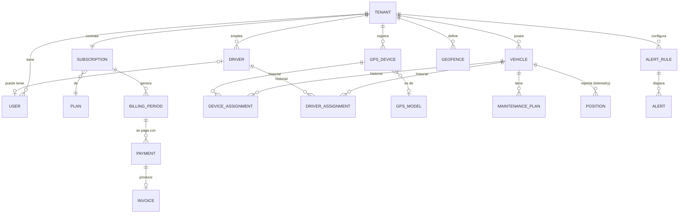

# MVP — Telemetría vehicular

- Estado: **borrador para revisión** (2026-11-05).
- Alcance: toda la plataforma (core-service, telemetry-service, realtime-gateway, api-gateway, frontend). Vive aquí
  porque core-service es el dueño del modelo de negocio; cada requisito indica el servicio responsable.
- Relación con el resto: [planning.md](planning.md) define módulos y fases; este documento fija **qué fases forman el
  MVP** y los requisitos de alto nivel (`MVP-FRn`, `MVP-NFRn`). Cada `phases/NN-*.md` detalla los suyos (`FLT-FR3`…) y
  cita el `MVP-*` del que salen.

## Visión
Plataforma para conectar **dueños de flotilla y choferes** con quien necesita **fletes y viajes**, y ofrecer
**telemetría** (seguimiento en vivo de unidades). Se construye por capas:

1. **MVP — telemetría**: una empresa registra su flota, instala GPS y ve sus unidades en vivo, su historial, alertas y
   reportes, pagando una mensualidad por vehículo. Es el producto que se vende primero y el que genera la base de
   transportistas con unidades ya rastreadas.
2. **Después — fletes y viajes**: gestión de viajes y órdenes sobre la flota rastreada (fases 6 y 7).
3. **Visión — conexión con terceros**: que personas o empresas pidan un flete o viaje y un transportista de la
   plataforma lo atienda. El modelo (marketplace abierto, B2B entre tenants o solo gestión interna) **está por decidir**
   y no condiciona el MVP. Ver [Decisiones aplazadas](#decisiones-aplazadas).

## Alcance
| Fase | Módulo | En el MVP | Nota |
|------|--------|-----------|------|
| 0 | foundation | ✅ hecho | specs 001–006 |
| 1 | tenancy | ✅ | specs 007–018 ya planificadas |
| 2 | fleet | ✅ | vehículos, GPS, asignaciones, conductores |
| 3 | identity | ✅ | usuarios y roles del tenant |
| 4 | billing | ✅ | planes, cobro **manual** por vehículo activo, factura digital, morosidad |
| 5 | telemetry-mapping | ✅ | junto con telemetry-service: mapa, historial, alertas, reportes |
| 6 | travels | ❌ | post-MVP |
| 7 | orders | ❌ | post-MVP |
| — | conexión con terceros | ❌ | visión; sin fase asignada |

**Fuera del MVP**: viajes y órdenes, marketplace, pasarela de pagos, app móvil nativa (el frontend web es
*responsive*), WhatsApp/SMS, webhooks al cliente, API pública para integradores, sedes múltiples, revendedores.

## Actores del MVP
Los de [planning.md § Actores](planning.md#actores-y-glosario): operador de plataforma, vendedor (registro), titular,
administrador del tenant, operador del tenant, solo lectura y conductor. Transportista y destinatario no existen en el
MVP.

**Conductor con acceso a la app** (decidido el 2026-11-05): el conductor sigue siendo un registro de la flota, pero el
administrador puede darle **usuario** (rol `driver`). Entra desde el móvil (PWA) para ver el vehículo que tiene
asignado, su resumen y su puntaje, y para usar el botón de pánico. **Quién maneja qué vehículo lo decide siempre el
administrador** con la asignación conductor ↔ vehículo; el conductor no se asigna a sí mismo (sin jornadas).

## Entidades
Mapa de entidades del MVP por servicio dueño. Los atributos son orientativos; el modelo lógico se cierra en el
planning de cada fase (el de tenancy ya está en [phases/01-tenancy.md](phases/01-tenancy.md#modelo-lógico-propuesta-para-revisión)).

### core-service
| Entidad | Qué es | Atributos clave | Ciclo de vida |
|---------|--------|-----------------|---------------|
| Tenant, titular, usuario, vendedor, catálogos, términos | Fase 1 | Ver [phases/01-tenancy.md](phases/01-tenancy.md#entidades-conceptuales) | Ver fase 1 |
| **Vehículo** | Unidad de la flota | placa (única entre activos del tenant), tipo, marca, modelo, año, color, VIN/serial (opc.), alias, vencimiento de seguro y de revisión, horario laboral (días y horas) | activo ⇄ inactivo → dado de baja |
| **Plan de mantenimiento** | Servicio periódico de un vehículo | tipo (aceite, cauchos…), cada N km u horas de motor, último servicio (fecha, km) | activo ⇄ inactivo |
| **Tipo de vehículo** | Catálogo de plataforma | moto, carro, camioneta, camión, autobús… | activo ⇄ inactivo |
| **Dispositivo GPS** | Equipo rastreador | IMEI, modelo (certificado o "otro"), línea (número SIM, operadora), origen (**provisto** por la plataforma / **propio** del cliente), `traccar_device_id` | registrado → activo ⇄ deshabilitado → dado de baja (nunca cambia de tenant) |
| **Asignación GPS ↔ vehículo** | Qué GPS estuvo en qué vehículo | gps, vehículo, desde, hasta | vigente → cerrada (inmutable al cerrar) |
| **Conductor** | Persona que maneja | nombre, cédula, teléfono, licencia (grado, vencimiento), usuario (opcional, rol `driver`) | activo ⇄ inactivo |
| **Asignación conductor ↔ vehículo** | Quién maneja qué unidad; la crea y cierra el administrador | conductor, vehículo, desde, hasta | vigente → cerrada |
| **Modelo de GPS certificado** | Catálogo de plataforma: equipos probados y soportados | fabricante, modelo, protocolo Traccar, capacidades (ignición, odómetro, entradas digitales, combustible, conducción brusca) | en prueba → certificado → retirado |
| **Plan** | Oferta comercial | nombre, precio por vehículo activo/mes, moneda, límites (vehículos, usuarios, retención de historial) | vigente → retirado |
| **Suscripción** | Plan contratado por un tenant | tenant, plan, inicio, día de corte | activa → morosa → solo lectura → cancelada |
| **Periodo de facturación** | Mes cobrado | desde, hasta, vehículos activos facturables, monto | abierto → emitido → pagado / vencido |
| **Pago** | Comprobante subido por el cliente | monto, moneda, método, referencia, comprobante (archivo), fecha | reportado → validado / rechazado |
| **Factura** | Documento fiscal digital | número de control, datos fiscales, montos, impuestos, archivo | emitida → anulada |
| **Comisión** | Lo que gana el vendedor por un pago | vendedor, pago, base, monto | calculada → pagada |

### telemetry-service (se diseña en su repo; aquí solo lo que el MVP exige)
| Entidad | Qué es | Atributos clave |
|---------|--------|-----------------|
| **Copia de mapeo** | `group → tenant`, `device + instante → vehículo`, recibida por eventos de core-service | — |
| **Posición** | Reporte del GPS | vehículo, instante (UTC), lat/lon, velocidad, rumbo, ignición, atributos crudos |
| **Evento del dispositivo** | Alarma del GPS | tipo (SOS, batería, corriente, ignición…), instante |
| **Recorrido / parada** | Segmentos derivados de las posiciones | inicio, fin, distancia, duración, punto de parada |
| **Resumen diario** | Agregado por vehículo, conductor y día para reportes | km, horas de motor, tiempo en movimiento / en ralentí / detenido, velocidad máxima, excesos, eventos de conducción brusca, nº de alertas |
| **Visita a geocerca** | Entrada y salida de un vehículo en una zona | geocerca, vehículo, conductor, entrada, salida, duración |
| **Geocerca** | Zona del tenant | nombre, forma (círculo / polígono), vehículos a los que aplica |
| **Regla de alerta** | Qué vigilar | tipo, umbral (velocidad, minutos sin reportar…), geocerca, vehículos, destinatarios |
| **Alerta** | Instancia disparada | regla, vehículo, instante, posición, estado (nueva → vista) |

## Requisitos funcionales
| ID | Requisito | Servicio | Fase |
|----|-----------|----------|------|
| MVP-FR1 | Una empresa o persona se registra sola o la da de alta el operador de plataforma; su titular entra con Keycloak | core | 1 |
| MVP-FR2 | El administrador del tenant registra, edita, desactiva y da de baja **vehículos** | core | 2 |
| MVP-FR3 | El administrador registra un **GPS por IMEI**, o el operador de plataforma registra uno provisto; queda creado en Traccar dentro del group del tenant | core + traccar-adapter | 2 |
| MVP-FR4 | Un GPS se **asigna** a un vehículo, se reasigna a otro del mismo tenant o se retira, conservando el historial | core | 2 |
| MVP-FR5 | El administrador registra **conductores** y los asigna a vehículos con historial | core | 2 |
| MVP-FR6 | El administrador invita usuarios, les da rol (admin, operador, solo lectura) y los deshabilita | core + Keycloak | 3 |
| MVP-FR7 | **Mapa en vivo**: los usuarios del tenant ven la última posición y el estado de cada vehículo (en movimiento, detenido, apagado, sin reportar) y se actualiza sin recargar | telemetry + realtime | 5 |
| MVP-FR8 | **Historial**: reproducir el recorrido de un vehículo en un rango de fechas, con paradas y velocidades | telemetry | 5 |
| MVP-FR9 | **Geocercas**: el tenant crea, edita y borra zonas (círculo o polígono) | telemetry (dueño por decidir) | 5 |
| MVP-FR10 | **Alertas**: exceso de velocidad, entrada/salida de geocerca, alarmas del GPS (SOS, batería, corriente) y sin reportar N minutos; se configuran por vehículo o grupo de vehículos | telemetry | 5 |
| MVP-FR11 | Las alertas llegan **en la app en vivo** con historial consultable y **por email** a los usuarios suscritos | telemetry + realtime | 5 |
| MVP-FR12 | **Reportes** por vehículo, conductor y periodo, exportables a CSV/PDF (ver [Reportes del MVP](#reportes-del-mvp)) | telemetry | 5 |
| MVP-FR19 | El administrador da **usuario** a un conductor; el conductor entra desde el móvil y ve solo su información | core + Keycloak | 3 |
| MVP-FR20 | El conductor ve la ubicación del vehículo que tiene **asignado**, su resumen del día (km, horas, alertas) y su **puntaje de conductor**; nada de otros conductores ni vehículos | telemetry | 5 |
| MVP-FR21 | **Botón de pánico** en la app del conductor: genera una alerta de máxima prioridad con su última posición, igual que el SOS del GPS | telemetry + realtime | 5 |
| MVP-FR22 | **Mantenimiento preventivo**: el administrador define recordatorios por km u horas de motor (cambio de aceite, cauchos…) y recibe una alerta al cumplirse | core + telemetry | 5 |
| MVP-FR23 | **Vencimientos**: alerta de licencia de conducir, seguro y revisión del vehículo próximos a vencer | core | 2 |
| MVP-FR13 | El operador de plataforma gestiona **planes**; cada tenant tiene una **suscripción** | core | 4 |
| MVP-FR14 | Cada mes se calcula el cobro por **vehículo con GPS activo** y se notifica al titular | core | 4 |
| MVP-FR15 | El cliente sube el **comprobante de pago**; el operador de plataforma lo valida o rechaza | core | 4 |
| MVP-FR16 | Cada pago validado genera una **factura digital** enviada por correo | core | 4 |
| MVP-FR17 | A los **5 días** de impago el tenant pasa a **solo lectura** (los GPS siguen reportando); al pagar se reactiva | core | 1 + 4 |
| MVP-FR18 | El operador de plataforma ve un **panel**: tenants por estado, vehículos activos, pagos por validar, GPS sin reportar | core | 4 |

## Reportes del MVP
Criterio: cada reporte responde una pregunta que el cliente paga por contestar (costes, uso de la flota, conducta de
sus conductores, cumplimiento). Los marcados con **(GPS)** dependen de que el equipo lo soporte; el resto sale solo de
las posiciones.

| Reporte | Pregunta del cliente | Datos |
|---------|----------------------|-------|
| Recorridos y kilometraje | ¿Cuánto rodó cada unidad? | Km por vehículo/conductor/día, recorridos con inicio, fin y duración |
| Uso de la flota | ¿Tengo unidades ociosas? | Horas de motor, tiempo en movimiento, en ralentí y detenido; días sin uso |
| Paradas | ¿Dónde y cuánto se detienen? | Paradas mayores a N minutos con dirección y duración |
| Excesos de velocidad | ¿Quién maneja peligroso? | Eventos sobre el límite, duración, velocidad máxima, lugar |
| Ralentí | ¿Cuánto combustible pierdo con el motor encendido detenido? | Tiempo de ralentí por vehículo/conductor |
| Visitas a geocercas | ¿Llegó al cliente, cuánto se quedó? | Entradas, salidas y permanencia por zona |
| Fuera de horario | ¿Usan las unidades sin permiso? | Movimientos fuera del horario laboral de **cada vehículo** |
| Puntaje de conductor | ¿Quién es mi mejor y peor conductor? | Excesos, ralentí y **(GPS)** frenadas/aceleraciones bruscas, normalizados por km. Cada conductor ve el suyo en la app |
| Alertas | ¿Qué pasó en mi flota? | Alertas por tipo, vehículo y conductor |
| Mantenimiento | ¿Qué unidades necesitan servicio? | Km/horas desde el último servicio frente al plan de mantenimiento |
| Combustible **(GPS)** | ¿Cuánto consume y hay robo? | Nivel, cargas y caídas bruscas; solo con sensor de combustible o CAN |

Fuera del MVP: temperatura (cadena de frío), puertas, reportes programados por email y comparativas entre periodos.

## Requisitos no funcionales
| ID | Requisito | Medida |
|----|-----------|--------|
| MVP-NFR1 | **Aislamiento por tenant** en todos los servicios | Ninguna lectura o escritura cruza tenants; test de aislamiento por repositorio; el tenant sale del token |
| MVP-NFR2 | **Frescura del mapa en vivo** | Una posición recibida por Traccar se ve en el mapa en **≤ 5 s** (p95) |
| MVP-NFR3 | **Latencia de alertas** | Una alerta se muestra en la app en **≤ 10 s** y sale por email en **≤ 2 min** desde la posición que la dispara |
| MVP-NFR4 | **Consultas** | APIs de negocio **≤ 300 ms** p95; historial de un día de un vehículo **≤ 2 s**; reporte mensual de 50 vehículos **≤ 10 s** |
| MVP-NFR5 | **Capacidad objetivo** | 50 tenants, 1 000 vehículos, un reporte cada 30 s (~35 posiciones/s sostenidas, picos ×3) en la VM ARM de Oracle |
| MVP-NFR6 | **Retención** | Posiciones en crudo **6 meses** (configurable por plan); resúmenes diarios **2 años**; auditoría **5 años** |
| MVP-NFR7 | **Disponibilidad** | Objetivo 99 % mensual; una caída de Traccar, NATS o telemetry-service no impide gestionar tenants ni cobrar; no se pierden posiciones si cae telemetry-service (JetStream las retiene) |
| MVP-NFR8 | **Respaldo** | Backup diario cifrado de MySQL fuera de la VM; RPO 24 h, RTO 4 h; restauración probada antes del primer cliente |
| MVP-NFR9 | **Seguridad** | TLS en todo tráfico externo; Keycloak para usuarios (OIDC) y servicios (client credentials); roles verificados en cada servicio; secretos fuera del repo |
| MVP-NFR10 | **Datos personales** | Mínimos (cédula, teléfono, correo); nunca en logs; acceso solo por su tenant y el operador de plataforma |
| MVP-NFR11 | **Auditoría** | Toda escritura registra actor, tenant, operación y resultado |
| MVP-NFR12 | **Observabilidad** | Logs JSON con correlation id, health/readiness por servicio, alerta interna si Traccar deja de recibir posiciones |
| MVP-NFR13 | **Localización** | Interfaz en español; horas mostradas en `America/Caracas`, guardadas en UTC; dinero en enteros de la unidad mínima + moneda |
| MVP-NFR14 | **Clientes** | Web *responsive* (escritorio y móvil) en las dos últimas versiones de Chrome, Edge, Firefox y Safari; la app del conductor es una **PWA** instalable en Android 10+ e iOS 16+, usable con datos móviles lentos (pantalla inicial ≤ 300 KB) |
| MVP-NFR17 | **Independencia del hardware** | Ninguna regla de negocio depende de un modelo de GPS concreto; lo específico del equipo se lee de sus capacidades en el catálogo y los reportes que no aplican se ocultan |
| MVP-NFR15 | **Coste** | Todo el MVP corre en la VM ARM gratuita de Oracle + Vercel; ningún servicio de pago obligatorio salvo dominio, correo transaccional y, si aplica, imprenta digital |
| MVP-NFR16 | **Mantenibilidad** | Hexagonal por servicio, contratos OpenAPI verificados por tests, `pnpm check` en CI, una migración revisada por cambio de esquema |

## Criterio de salida del MVP
No hay cliente piloto (2026-11-05), así que la salida se valida en dos pasos:

1. **Piloto interno**: al menos 3 vehículos propios o de conocidos, con al menos 2 modelos de GPS certificados,
   durante 4 semanas, con conductores usando la app (su vehículo, su puntaje y el botón de pánico). Se miden MVP-NFR2, NFR3 y NFR7.
2. **Primer cliente**: un cliente real usa mapa, historial, alertas y reportes un mes completo; ese mes se cobra con el
   flujo de pago manual y se emite su factura digital.
3. Se prueba la morosidad de punta a punta en un tenant de prueba (gracia → solo lectura → pago → reactivación).
4. Se cumplen MVP-NFR1, NFR2, NFR7 y NFR8 en producción.

## Decisiones aplazadas
| Tema | Opciones | Cuándo se decide |
|------|----------|------------------|
| Conexión con terceros (fletes/viajes) | Marketplace abierto (usuarios fuera de los tenants), B2B entre tenants, solo gestión interna | Antes de planificar la fase 6; condiciona si travels/orders necesitan actores que crucen tenants |
| Dueño de las geocercas | core-service (y se sincronizan por eventos) o telemetry-service | Design de telemetry-service (fase 5) |
| Grupos de vehículos | Etiquetas libres o grupos jerárquicos (por sede, cliente, ruta) | Planning de la fase 2 |
| Sedes del tenant | Ninguna en el MVP o sede como filtro de vehículos | Planning de la fase 2 |
| Inventario de GPS | GPS registrado sin vehículo (stock del operador de plataforma) | Planning de la fase 2 |
| Facturación fiscal | Imprenta digital autorizada por el SENIAT vs. otro mecanismo; moneda (VES/USD) | Planning de la fase 4 |
| Retención por plan | Igual para todos o diferente por plan (MVP-NFR6) | Planning de la fase 4 |

## Selección de GPS
No hay modelo definido (2026-11-05). Se certifican **2 modelos** antes del piloto interno: uno económico para rastreo
básico y uno con entradas para sensores. Criterios:

| Criterio | Mínimo | Deseable |
|----------|--------|----------|
| Soporte en Traccar | Protocolo nativo, probado con un equipo real | Comandos remotos (corte de motor, cambiar intervalo) |
| Red | 4G/LTE (2G y 3G en retirada) con respaldo 2G | Funciona con las operadoras de Venezuela (Movistar, Digitel, Movilnet) |
| Datos | Ignición (ACC), velocidad, rumbo, odómetro | Acelerómetro (conducción brusca), entradas digitales/analógicas, CAN/OBD o sensor de combustible |
| Alarmas | SOS, corte de corriente, batería baja | Remolque, manipulación |
| Operación | Batería interna, memoria para reportes sin cobertura | Configuración remota por SMS o plataforma |
| Comercial | Disponible en Venezuela con garantía y repuesto | Precio que permita venderlo o financiarlo dentro del plan |

Mientras no se elija, MVP-NFR5 (capacidad) sigue siendo una hipótesis y el desarrollo de la fase 2 puede avanzar con
el simulador de Traccar (`osmand`) y un teléfono como GPS.

## Preguntas abiertas
Ninguna por ahora; las de cada fase se abren en su planning.

## Respuestas registradas
| Fecha | Pregunta | Respuesta |
|-------|----------|-----------|
| 2026-11-05 | ¿Hay cliente piloto? | No. Se valida con un piloto interno (ver criterio de salida) |
| 2026-11-05 | ¿Qué GPS se vende? | No definido. Se certifican 2 modelos con los criterios de [Selección de GPS](#selección-de-gps) |
| 2026-11-05 | ¿Reportes con sensores? | Sí, los que aporten valor al cliente; los que dependen del equipo se marcan **(GPS)** |
| 2026-11-05 | ¿El conductor entra a la app? | Sí: ve su vehículo asignado, su resumen y su puntaje, y tiene botón de pánico |
| 2026-11-05 | ¿Jornadas (el conductor se asigna el vehículo)? | No. La asignación conductor ↔ vehículo la hace siempre el administrador; sin jornadas no hace falta QR por unidad |
| 2026-11-05 | ¿El conductor ve su puntaje? | Sí (MVP-FR20) |
| 2026-11-05 | ¿Horario laboral por tenant o por vehículo? | Por vehículo (atributo del vehículo) |
