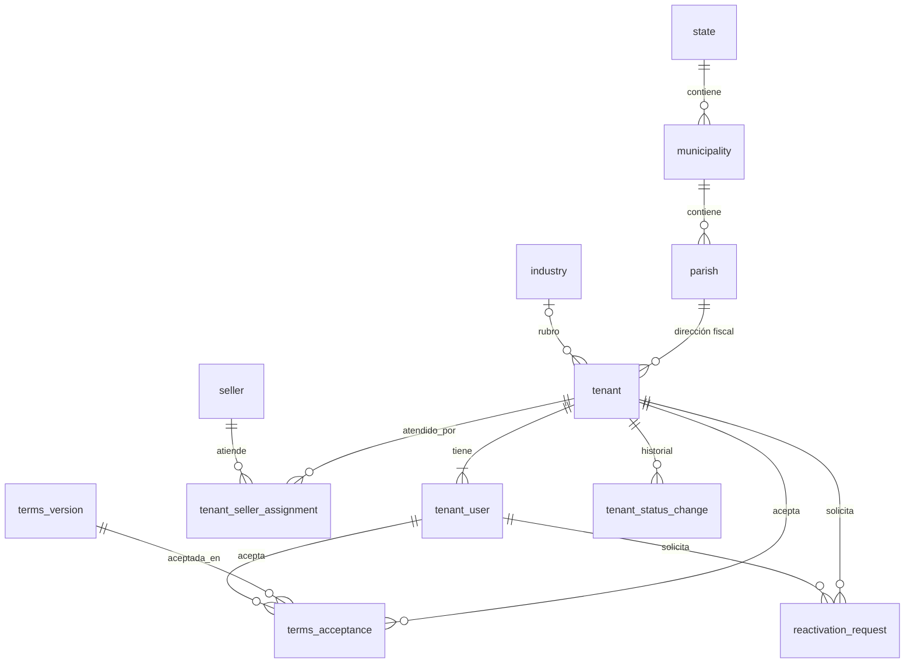

# Fase 1 — tenancy

- Estado: **requisitos cerrados** (2026-10-20): entidades, reglas, modelo lógico y PADR-005 aprobados; specs por
  redactar (ver [Specs de la fase](#specs-de-la-fase)).
- Mapa: [../planning.md](../planning.md) (reglas comunes y **actores**: no se repiten aquí).
- Objetivo de la fase: **un tenant puede existir, entrar, quedar en solo lectura, cerrarse y reactivarse**. Se crea
  por autoregistro o lo da de alta el operador de plataforma (atribuido a un vendedor); su titular inicia sesión con
  Keycloak y el tenant tiene su group en Traccar.

## Punto de partida
- Fase 0 cerrada: actor con `tenant_id` y roles desde el token (PADR-004), aislamiento por tenant, auditoría, contrato
  OpenAPI.
- Keycloak hace login, recuperación y cambio de contraseña y verificación de correo (Authorization Code + PKCE,
  PADR-004 §1). core-service **no** maneja contraseñas ni pantallas de autenticación.
- `tenant_id` solo lo escribe un administrador del realm (PADR-004 §2) → el registro nativo de Keycloak no sirve para
  crear un tenant; el usuario lo crea core-service por la Admin API.

## Flujos
### Autoregistro
1. El visitante llena el formulario público y acepta los términos vigentes.
2. core-service valida, crea el tenant en `PENDING_VERIFICATION` y su titular, y encola el aprovisionamiento. Canal
   `SELF_SERVICE`, sin vendedor.
3. Aprovisionamiento (con reintentos): usuario en Keycloak con `tenant_id` y `tenant-admin`; Keycloak le envía el correo
   para verificar su dirección y definir su contraseña.
4. El titular verifica el correo e inicia sesión → el frontend llama a `GET /v1/me` → core-service ve
   `email_verified = true` en el token, pasa el tenant a `ACTIVE` y encola la creación del group en Traccar.
5. Sin verificar en 30 días (el enlace se puede reenviar) → `EXPIRED`; se liberan documento y correo.

### Alta asistida (por el operador de plataforma)
Igual que el autoregistro, pero la inicia el operador de plataforma, con canal `SALES` y vendedor obligatorio. El
titular acepta los términos en su primer inicio de sesión y entonces activa (paso 4).

### Suspensión
El operador de plataforma suspende con motivo. El tenant queda en **solo lectura** y sus GPS deshabilitados en
Traccar. Levantar la suspensión lo devuelve a `ACTIVE`.

### Cierre
El titular o el operador de plataforma cierra el tenant (con confirmación), aunque tenga pagos pendientes. Usuarios
(salvo el titular), vehículos y GPS quedan deshabilitados **por cierre**. El titular solo puede consultar el estado y
**solicitar la reactivación**. Nada se borra.

### Reactivación
1. El titular de un tenant cerrado solicita la reactivación.
2. El operador de plataforma la aprueba solo si la deuda está saldada, o la rechaza con motivo.
3. Aprobada → `ACTIVE`; se reactiva **exactamente** lo que se deshabilitó por el cierre (usuarios, vehículos, GPS). Lo
   que ya estaba deshabilitado antes del cierre sigue así.
4. Si alguien intenta registrarse con el documento de un tenant cerrado, recibe la respuesta uniforme del
   autoregistro y el titular registrado recibe un correo indicando cómo solicitar la reactivación.

## Requisitos
### Funcionales
| ID | Requisito |
|----|-----------|
| TEN-FR1 | **Autoregistro** público: titular (natural o jurídica), dirección fiscal y primer administrador (el titular) en un solo formulario, con aceptación de términos. Nunca genera comisión. |
| TEN-FR2 | **Alta asistida** por el operador de plataforma, con los mismos datos más el vendedor; el titular acepta los términos en su primer inicio de sesión. |
| TEN-FR3 | **Documento del titular**: RIF (con dígito verificador válido) para persona jurídica, CI para persona natural; único en la plataforma salvo tenants `EXPIRED`. |
| TEN-FR4 | **Aprovisionamiento del titular** en Keycloak (Admin API, client credentials): `tenant_id`, rol `tenant-admin`, verificación de correo y definición de contraseña delegadas a Keycloak. Con reintento; nunca queda un usuario sin tenant ni un tenant activo sin titular. |
| TEN-FR5 | **Activación** cuando el titular verifica su correo (y, en alta asistida, acepta los términos). |
| TEN-FR6 | **Vencimiento** de altas sin verificar a los 30 días; reenvío del enlace mientras tanto. |
| TEN-FR7 | **Titular de la cuenta**: cada tenant tiene exactamente un `tenant-admin` marcado como titular. La transferencia llega con identity (fase 3). |
| TEN-FR8 | **Group de Traccar** del tenant al activarse (vía traccar-adapter), con reintento. |
| TEN-FR9 | **Suspensión** por el operador de plataforma, con motivo: solo lectura y GPS deshabilitados. Levantarla → `ACTIVE`. |
| TEN-FR10 | **Modo solo lectura**: en un tenant `SUSPENDED` (y, desde la fase 4, moroso) toda escritura de sus usuarios responde `403` con un código propio; las lecturas funcionan. |
| TEN-FR11 | **Cierre** por el titular o por el operador de plataforma, aun con deuda; deshabilita por cierre todo salvo el acceso del titular. |
| TEN-FR12 | **Reactivación**: la solicita el titular; la aprueba el operador de plataforma con la deuda saldada; restaura lo deshabilitado por el cierre. |
| TEN-FR13 | **Atribución comercial**: canal (`SELF_SERVICE` / `SALES`) y vendedor con historial; el operador puede cambiar el vendedor de un tenant `SALES`. Las comisiones se calculan en billing (fase 4). |
| TEN-FR14 | **Vendedores**: el operador de plataforma los registra, edita y desactiva (sin login en el MVP). |
| TEN-FR15 | **Rubros**: catálogo administrado por el operador de plataforma; el formulario ofrece el catálogo y, si no aparece, un rubro escrito por el usuario. Obligatorio solo para persona jurídica. |
| TEN-FR16 | **Dirección fiscal** con parroquia del catálogo geográfico de Venezuela (estado → municipio → parroquia). |
| TEN-FR17 | El operador de plataforma **lista y consulta** tenants (filtros: estado, canal, vendedor, rubro) y sus solicitudes de reactivación. |
| TEN-FR18 | El administrador del tenant **consulta y edita** los datos de su tenant (el tipo y el documento del titular no se editan). |

### No funcionales
| ID | Requisito |
|----|-----------|
| TEN-NFR1 | El endpoint de autoregistro es público y está protegido contra abuso: límite de peticiones (api-gateway) y captcha. |
| TEN-NFR2 | El autoregistro no revela si un correo o documento ya existe (respuesta uniforme; el aviso llega por correo). |
| TEN-NFR3 | Aprovisionamiento, suspensión, cierre y reactivación en Keycloak y Traccar idempotentes y reintentables (outbox); una caída de Keycloak o Traccar no pierde operaciones. |
| TEN-NFR4 | Datos personales mínimos y nunca en logs; auditoría de toda escritura (FND-FR9). |
| TEN-NFR5 | El modelo lógico está normalizado al menos a 3FN; las operaciones que cambian varias entidades son transaccionales (ACID) y los efectos externos salen por outbox en la misma transacción. |

## Estados del tenant
```
                       (30 días)
PENDING_VERIFICATION ──────────► EXPIRED
         │
         │ correo verificado (+ términos)
         ▼
      ACTIVE ◄──── operador ────► SUSPENDED (solo lectura)
       │  ▲                          │
       │  └── reactivación aprobada ─┼──┐
       ▼                             ▼  │
     CLOSED ◄────────────────────────┘──┘
```
| Estado | Usuarios del tenant | GPS |
|--------|---------------------|-----|
| `PENDING_VERIFICATION` | Solo el titular, solo `GET /v1/me` (y aceptar términos) | — |
| `ACTIVE` | Normal | Habilitados |
| `SUSPENDED` | Solo lectura | Deshabilitados |
| `CLOSED` | Solo el titular: ver estado y solicitar reactivación | Deshabilitados |
| `EXPIRED` | Ninguno | — |

Morosidad (fase 4): a los 5 días de impago, solo lectura con el mismo mecanismo de TEN-FR10 y GPS deshabilitados.

## Entidades (conceptuales)
| Entidad | Qué es | Alcance | Ciclo de vida |
|---------|--------|---------|---------------|
| **Tenant** | La cuenta cliente. Incluye los datos de su **titular** (persona jurídica o natural, 1:1 que no cambia) | Raíz del aislamiento | Estados de arriba |
| **Usuario del tenant** | Persona que inicia sesión en nombre de un tenant. En esta fase solo el titular | Tenant | Pendiente de aprovisionar → invitado → activo ⇄ deshabilitado |
| **Dirección** | Value object: ubicación fiscal del tenant (se reutilizará en sedes) | La de su dueño | La de su dueño |
| **Estado / Municipio / Parroquia** | Catálogo geográfico de Venezuela, jerárquico | Plataforma | Datos de referencia |
| **Rubro** | Catálogo de actividades económicas | Plataforma | Activo ⇄ inactivo |
| **Vendedor** | Vendedor interno que trae clientes | Plataforma | Activo ⇄ inactivo |
| **Asignación de vendedor** | Qué vendedor atiende a un tenant y desde/hasta cuándo | Tenant | Vigente → cerrada |
| **Términos** | Versión publicada de los términos y condiciones | Plataforma | Vigente → reemplazada |
| **Aceptación de términos** | Qué versión aceptó un tenant, quién y cuándo | Tenant | Inmutable |
| **Cambio de estado** | Historial de transiciones del tenant: de, a, motivo, actor, fecha | Tenant | Inmutable |
| **Solicitud de reactivación** | Pedido del titular de un tenant cerrado | Tenant | Pendiente → aprobada / rechazada |
| **Tarea de aprovisionamiento** | Outbox: efecto pendiente en Keycloak o Traccar | Interna | Pendiente → hecha / fallida |

## Reglas de negocio
**Titular y documento**
- **RN-01** — Un tenant tiene un solo titular: persona jurídica (RIF) o natural (CI). Tipo y documento no cambian.
- **RN-02** — RIF: letra `J, G, V, E, P, C` + 8 dígitos + dígito verificador **validado**. CI: `V` o `E` + número. Se
  guardan normalizados (`J-12345678-9`, `V-12345678`).
- **RN-03** — El documento es único en toda la plataforma, salvo en tenants `EXPIRED` (un cerrado se reactiva, no se
  vuelve a registrar).
- **RN-04** — Persona jurídica: razón social, rubro, correo y teléfono de la empresa obligatorios. Persona natural:
  el nombre del tenant es el del titular, rubro opcional, correo y teléfono son los del titular.
- **RN-05** — Rubro: uno del catálogo **o** uno escrito, nunca ambos.
- **RN-06** — Dirección fiscal obligatoria; la parroquia determina municipio y estado (no se guardan por separado).

**Usuarios**
- **RN-07** — Exactamente un titular por tenant, con rol `tenant-admin`.
- **RN-08** — Un usuario pertenece a un solo tenant; su correo es único en la plataforma salvo en tenants `EXPIRED`.
- **RN-09** — core-service nunca recibe ni guarda contraseñas.

**Alta y comercial**
- **RN-10** — Autoregistro: canal `SELF_SERVICE`, sin vendedor, nunca comisiona.
- **RN-11** — Alta asistida: solo `platform-operator`, canal `SALES`, vendedor **activo** obligatorio.
- **RN-12** — Un tenant `SALES` tiene exactamente una asignación de vendedor vigente; el operador la cambia cerrando la
  vigente y abriendo otra. Lo ya comisionado no cambia de vendedor.
- **RN-13** — Todo tenant activo tiene aceptada la versión vigente de los términos, aceptada por su titular (en el
  formulario o, en alta asistida, en su primer inicio de sesión).

**Estados**
- **RN-14** — Activa cuando el titular verifica el correo y hay términos aceptados.
- **RN-15** — Sin verificar a los 30 días → `EXPIRED`; libera documento y correo (el usuario de Keycloak se elimina:
  nunca tuvo actividad).
- **RN-16** — Solo `platform-operator` suspende y levanta una suspensión; el motivo es obligatorio.
- **RN-17** — Suspendido: solo lectura para sus usuarios y GPS deshabilitados en Traccar.
- **RN-18** — Cierran el titular o `platform-operator`, con confirmación, aunque haya deuda; la deuda se conserva.
- **RN-19** — Cerrado: usuarios (salvo el titular), vehículos y GPS deshabilitados **con causa "cierre"**; el titular
  solo consulta el estado y solicita la reactivación.
- **RN-20** — Una sola solicitud de reactivación pendiente por tenant. La aprueba o rechaza `platform-operator`; para
  aprobar, la deuda debe estar saldada.
- **RN-21** — Al reactivar se rehabilita solo lo deshabilitado con causa "cierre". Fleet (fase 2) cumple la misma regla
  para vehículos y GPS.
- **RN-22** — Toda transición de estado queda en el historial con actor y motivo.

## Modelo lógico (propuesta para revisión)
MySQL, esquema `core`. Ids `CHAR(36)` UUID v7 salvo catálogos geográficos (enteros). Todas las tablas de entidad llevan
`created_at` y `updated_at` (UTC); se omiten abajo. ⚑ = con `tenant_id` → aislamiento y test de aislamiento.



### Catálogos de plataforma
| Tabla | Columnas | Claves y restricciones |
|-------|----------|------------------------|
| `state` | `id`, `code` (ISO 3166-2:VE), `name` | UQ `code` |
| `municipality` | `id`, `state_id`, `name` | FK `state`; UQ (`state_id`, `name`) |
| `parish` | `id`, `municipality_id`, `name` | FK `municipality`; UQ (`municipality_id`, `name`) |
| `industry` | `id`, `code`, `name`, `active` | UQ `code`, UQ `name` |
| `seller` | `id`, `document_number` (CI), `first_name`, `last_name`, `email`, `phone`, `active` | UQ `document_number`, UQ `email` |
| `terms_version` | `id`, `version`, `document_url`, `content_hash`, `published_at` | UQ `version`. Vigente = la de `published_at` más reciente ≤ ahora |

### Tenant y lo que cuelga de él
| Tabla | Columnas | Claves y restricciones |
|-------|----------|------------------------|
| `tenant` | `id`, `holder_type` (`LEGAL_ENTITY`/`NATURAL_PERSON`), `document_number`, `legal_name`, `trade_name`?, `industry_id`?, `industry_other`?, `email`, `phone`, `fiscal_parish_id`, `fiscal_address_line`, `fiscal_postal_code`?, `status`, `channel`, `traccar_group_id`?, `expires_at`? | FK `industry`, FK `parish`; UQ (`holder_type`, `document_key`)ᵃ; UQ `traccar_group_id`; CHECK rubro (RN-04, RN-05) |
| `tenant_user` ⚑ | `id`, `tenant_id`, `keycloak_user_id`?, `email`, `first_name`, `last_name`, `phone`?, `is_owner`, `status`, `disabled_cause`? (`MANUAL`/`TENANT_CLOSED`) | FK `tenant`; UQ `keycloak_user_id`; UQ `email_key`ᵃ; UQ `owner_key`ᵇ |
| `tenant_seller_assignment` ⚑ | `id`, `tenant_id`, `seller_id`, `valid_from`, `valid_to`?, `assigned_by` (sub) | FK `tenant`, `seller`; UQ `open_key`ᵇ (una vigente por tenant) |
| `terms_acceptance` ⚑ | `id`, `tenant_id`, `terms_version_id`, `accepted_by_user_id`, `accepted_at` | FK `tenant`, `terms_version`, `tenant_user`; UQ (`tenant_id`, `terms_version_id`) |
| `tenant_status_change` ⚑ | `id`, `tenant_id`, `from_status`?, `to_status`, `reason`?, `actor_id` (sub), `actor_kind`, `occurred_at` | FK `tenant`. Inmutable |
| `reactivation_request` ⚑ | `id`, `tenant_id`, `requested_by_user_id`, `requested_at`, `status`, `resolved_by`?, `resolved_at`?, `resolution_note`? | FK `tenant`, `tenant_user`; UQ `pending_key`ᵇ (una pendiente por tenant) |
| `outbox_task` | `id`, `tenant_id`?, `kind`, `payload` (JSON), `status`, `attempts`, `next_attempt_at`, `last_error`? | Índice (`status`, `next_attempt_at`) |

`?` = admite nulo.
ᵃ Columna generada que vale `NULL` cuando el tenant está `EXPIRED` (MySQL admite varios `NULL` en un índice único):
así el documento y el correo se liberan sin borrar filas (RN-03, RN-08, RN-15). En `tenant_user` exige copiar el
estado relevante o marcar el usuario como `EXPIRED`; lo resuelve el design.
ᵇ Columna generada que vale el `tenant_id` solo cuando la condición se cumple (`is_owner`, `valid_to IS NULL`,
`status = 'PENDING'`) y `NULL` si no: el índice único garantiza "como mucho uno" en la base de datos. "Al menos uno"
(un titular, una asignación en `SALES`) lo garantiza la transacción del caso de uso.

### Decisiones de normalización
- **Sin `document_type`**: con RN-01, el tipo de documento depende del tipo de titular (RIF ↔ jurídica, CI ↔
  natural); guardarlo sería una dependencia transitiva (viola 3FN). Se deriva de `holder_type`.
- **Dirección sin estado ni municipio**: dependen de la parroquia (dependencia transitiva); se obtienen por join.
- **Vendedor fuera de `tenant`**: un tenant tiene varios vendedores en el tiempo (RN-12) → tabla de asignaciones con
  vigencia; el vendedor actual es la asignación abierta. Billing calcula comisiones con esa vigencia.
- **`legal_name`, `email`, `phone` de una persona natural se guardan en `tenant`** aunque al crearse coincidan con los
  del titular: son datos del titular legal, no del usuario (la titularidad de la cuenta podrá transferirse en la fase 3
  sin cambiar el titular legal). No hay dependencia funcional entre ambas tablas.
- **`tenant.status` y el historial**: el estado actual podría derivarse del último cambio; se guarda en `tenant` por
  rendimiento y para bloquear la fila en las transiciones. Es una desnormalización controlada: ambas escrituras van en
  la misma transacción.
- **`disabled_cause`**: permite que la reactivación restaure solo lo deshabilitado por el cierre (RN-21) sin tablas de
  instantáneas. Fleet usará el mismo patrón.

### Transacciones (ACID + outbox)
| Caso de uso | En una transacción | Outbox |
|-------------|--------------------|--------|
| Alta (ambos canales) | `tenant`, `tenant_user` (titular), `terms_acceptance` (autoregistro), `tenant_seller_assignment` (asistida), `tenant_status_change` | `KEYCLOAK_CREATE_USER` |
| Activación | `tenant.status`, `tenant_user.status`, `tenant_status_change` | `TRACCAR_CREATE_GROUP` |
| Vencimiento | `tenant.status`, `tenant_user.status`, `tenant_status_change` | `KEYCLOAK_DELETE_USER` |
| Suspensión / levantarla | `tenant.status`, `tenant_status_change` | `TRACCAR_SET_GROUP_DEVICES` (deshabilitar / habilitar) |
| Cierre | `tenant.status`, usuarios → `DISABLED` + `TENANT_CLOSED`, `tenant_status_change` | `KEYCLOAK_DISABLE_USERS`, `TRACCAR_SET_GROUP_DEVICES` |
| Reactivación aprobada | `reactivation_request`, `tenant.status`, usuarios `TENANT_CLOSED` → `ACTIVE`, `tenant_status_change` | `KEYCLOAK_ENABLE_USERS`, `TRACCAR_SET_GROUP_DEVICES` |
| Cambio de vendedor | cerrar asignación vigente + abrir otra | — |

**GPS en esta fase**: traccar-adapter solo habilita y deshabilita devices de uno en uno (`/devices/{id}/enable|disable`)
y en la fase 1 todavía no hay GPS. Las tareas de GPS de suspensión, cierre y reactivación las implementa fleet
(fase 2) recorriendo los GPS del tenant, con `disabled_cause` (RN-21). En la fase 1 solo se emite el cambio de estado.

## Decisiones de la fase
| Tema | Decisión | Estado |
|------|----------|--------|
| Login, recuperación, verificación de correo | Keycloak (pantallas con tema propio), no core-service | Propuesta |
| Contraseña del titular | La define el usuario en Keycloak desde el correo; core-service nunca la ve | Propuesta |
| Activación | Al verificar el correo (+ términos en alta asistida) | Aceptada (2026-10-20) |
| Cómo se entera core-service de la verificación | Claim `email_verified` del token en `GET /v1/me` (sin listeners en Keycloak) | Propuesta |
| Titular | `tenant-admin` con marca única de titular | Aceptada (2026-10-20) |
| Sedes | Un tenant por titular; sedes en fleet (fase 2), varios administradores; restricción por sede después | Aceptada (2026-10-20) |
| Documento | RIF con dígito verificador validado (jurídica), CI (natural); único salvo `EXPIRED` | Aceptada (2026-10-20) |
| Comisión en autoregistro | Nunca; vincular un vendedor a posteriori es una funcionalidad futura | Aceptada (2026-10-20) |
| Cambio de vendedor | Permitido al operador, con historial; lo comisionado no cambia | Aceptada (2026-10-20) |
| Rubro | Catálogo + texto libre; obligatorio solo para persona jurídica | Aceptada (2026-10-20) |
| Dirección | Catálogo geográfico estado → municipio → parroquia | Aceptada (2026-10-20) |
| Términos en alta asistida | Los acepta el titular en su primer inicio de sesión | Aceptada (2026-10-20) |
| Altas sin verificar | `EXPIRED` a los 30 días; libera documento y correo | Aceptada (2026-10-20) |
| Suspensión | Solo lectura + GPS deshabilitados | Aceptada (2026-10-20) |
| Cierre | Titular u operador de plataforma, aun con deuda; el titular conserva acceso para pedir reactivación | Aceptada (2026-10-20) |
| Reactivación | La aprueba el operador con la deuda saldada; restaura lo deshabilitado por el cierre | Aceptada (2026-10-20) |
| Morosidad | Solo lectura y GPS deshabilitados a los 5 días de impago (detalle en fase 4) | Aceptada (2026-10-20) |
| Deuda en la reactivación | Port `OutstandingBalancePort`; "sin deuda" hasta que exista billing | Aceptada (2026-10-20) |
| Modelado | Entidades → reglas → modelo lógico en 3FN; transacciones ACID + outbox | Aceptada (2026-10-20) |
| Revendedores o distribuidores | Fuera del modelo; solo vendedores internos | Aceptada (2026-10-20) |
| Roles internos | Solo `platform-operator` en el MVP | Aceptada (2026-10-20) |
| Personas naturales como titular | Sí | Aceptada (2026-10-20) |
| Provisión en Keycloak | Service account de `core-service` con `manage-users`; registro nativo deshabilitado; `execute-actions-email` | Aceptada ([PADR-005](../../../../telemetry-infra/docs/platform/decisions/0005-tenant-signup-and-user-provisioning.md)) |
| Correos propios de core-service | Port de notificaciones (SMTP) para avisos que no envía Keycloak (documento ya registrado; luego facturas) | Aceptada (2026-10-20) |

## Preguntas abiertas
_Ninguna de la fase._ Resueltas el 2026-10-20:
- **Q20 — Deuda saldada antes de billing**: la reactivación consulta el saldo pendiente a través de un port
  (`OutstandingBalancePort`). Hasta que exista billing, su adaptador responde "sin deuda" (no puede haber deuda sin
  facturas); billing lo sustituye sin tocar tenancy.
- **Q21 — Aislamiento y operador de plataforma**: acceso explícito del operador de plataforma a varios tenants sin
  abrirlo a los usuarios de tenant; se resuelve en el design del spec del modelo.
- **Q22 — GPS en morosidad**: no siguen reportando; la morosidad deshabilita los GPS igual que la suspensión (fase 4).

## Specs de la fase
| Spec | Alcance | Requisitos | Depende de |
|------|---------|-----------|-----------|
| 007-platform-catalogs | Catálogo geográfico (con datos de Venezuela), rubros, versiones de términos; lectura pública para el formulario; gestión de rubros y términos por el operador | TEN-FR15, TEN-FR16 | — |
| 008-tenant-model | Tablas del tenant (tenant, usuario, historial, asignación de vendedor, aceptación, reactivación) y vendedores; dominio (máquina de estados, RIF/CI); repositorios con aislamiento y acceso explícito del operador de plataforma (Q21) | TEN-FR3, TEN-FR7, TEN-NFR5 | 007 |
| 009-outbox | Tabla y worker de tareas: transacción + outbox, reintentos con backoff, idempotencia | TEN-NFR3 | — |
| 010-keycloak-admin | `IdentityProviderPort` y adaptador Admin API: crear con atributo y rol, enviar acciones, habilitar, deshabilitar, eliminar; config del client | TEN-FR4 | 009, PADR-005 |
| 011-traccar-client | Cliente de traccar-adapter (client credentials, PADR-002): crear group | TEN-FR8 | 009 |
| 012-sellers | Gestión de vendedores por el operador de plataforma | TEN-FR14 | 008 |
| 013-tenant-signup | `POST /v1/signups` público: validación, captcha, respuesta uniforme, port de notificaciones, alta + outbox | TEN-FR1, TEN-FR3, TEN-NFR1, TEN-NFR2, TEN-NFR4 | 007, 008, 010 |
| 014-operator-tenants | Alta asistida, listado y consulta, cambio de vendedor | TEN-FR2, TEN-FR13, TEN-FR17 | 012, 013 |
| 015-tenant-activation | `GET /v1/me`, aceptación de términos en primer login, activación, reenvío del enlace, vencimiento a 30 días | TEN-FR5, TEN-FR6, TEN-FR8 | 011, 013 |
| 016-read-only-mode | Bloqueo de escrituras por estado del tenant; suspensión y levantamiento | TEN-FR9, TEN-FR10 | 015 |
| 017-closure-reactivation | Cierre, solicitud y resolución de reactivación, `OutstandingBalancePort` | TEN-FR11, TEN-FR12 | 016 |
| 018-tenant-profile | Consulta y edición de los datos del tenant por su administrador | TEN-FR18 | 015 |

Orden: 007 → 008 → 009 → 010 → 011 → 012 → 013 → 014 → 015 → 016 → 017 → 018. 009, 010 y 011 no dependen de 007/008
y pueden adelantarse; 018 puede ir en cualquier momento después de 015.

## Fuera de la fase
Gestión de usuarios del tenant más allá del titular y transferencia de titularidad (fase 3), sedes, vehículos y GPS
(fase 2; deben cumplir RN-21), planes, pagos, comisiones y morosidad (fase 4), transportistas y app de conductores
(fase 7), vincular un vendedor a un tenant de autoregistro (posterior).
